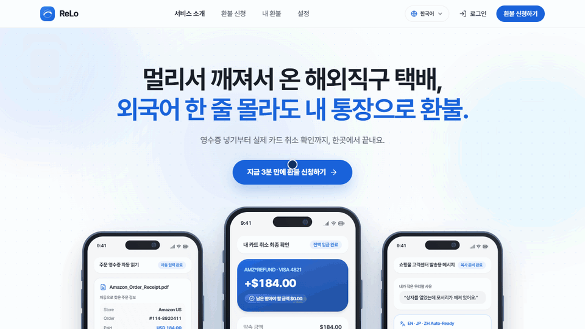

<div align="center">

# ReLo

**해외 직구 반품·교환·환불을 접수부터 회수까지 한곳에서 기록하는 웹 서비스**


</div>

<div align="center">

### 웹



**첫 화면 → 가입 → 영수증으로 신청 → 쇼핑몰에 보낼 메시지 → 답장 요약 → 입금 기록 → 환불 마무리**

약 80초(1.4배속) · [원래 속도 영상 보기 (WebM, 109초)](./docs/relo_web_demo.webm)

### 앱


**시작 화면 → 로그인 → 영수증으로 신청 → 판매자에게 메시지 → 답장 요약 → 입금 기록 → 환불 완료**

약 80초(1.25배속) · [원래 속도 영상 보기 (WebM, 96초)](./flutter_app/docs/relo_app_demo.webm) · [앱 README](./flutter_app/README.md)

</div>

> 두 영상 모두 화면과 흐름은 실제 그대로이고, AI 답만 실제 Gemini가 아닙니다. 웹은 시험 서버의 가짜 AI가 정해진 답을 돌려주며 영수증 · 입금 캡처도 예시 파일입니다. 앱은 서버 없이 앱에 들어 있는 체험 계정과 데모 데이터로 찍었습니다. 웹 영상의 회색 점은 누르는 곳을 보여 주려고 녹화할 때만 올린 것입니다.
>
> 앱 영상은 앱을 웹용으로 빌드해 찍었습니다. 그래서 맨 앞의 로고 화면은 기기의 시작 화면 대신, 앱이 같은 자리에 그리는 첫 장면을 0.8초 붙잡아 둔 것입니다. 앱은 켜면 체험 데이터가 보이는 홈으로 시작하므로, 로그인 화면을 보여 주려고 먼저 로그아웃합니다.

---

## 프로젝트 소개

아마존·알리익스프레스·타오바오 같은 해외 쇼핑몰에서 산 물건을 반품하거나 환불받으려면, 영어로 문의를 쓰고 답장을 기다리고 얼마를 돌려받았는지 직접 챙겨야 합니다.
ReLo는 **접수 → 판매처 문의 작성 → 진행 상황 추적 → 회수 확인**까지를 소비자 한 사람이 한눈에 관리하도록 돕는 B2C 웹 서비스입니다.

- **팀**: 오정훈 ([@jeonghun267](https://github.com/jeonghun267)) · 방승훈 ([@sbang0209](https://github.com/sbang0209))
- **오정훈 담당**: 서비스 설계, Node.js 백엔드(계층형 구조·SQLite·인증·메일), React 19 프론트엔드, Gemini 연동
- **진행 상황**: 웹은 핵심 기능까지 구현했고, 모바일 앱은 `flutter_app/` 폴더에서 별도 관리됩니다.
- **앱 전용 README**: Flutter 앱 실행 방법 및 아키텍처는 **[`flutter_app/README.md`](./flutter_app/README.md)** 문서를 참고하세요.

### 더 자세한 정리

지금까지 만든 것을 세 가지 눈으로 나눠 적었습니다. 각 문서는 다시 **앱 / 웹**으로 나뉩니다.

| 문서 | 내용 |
|---|---|
| [기술](./docs/README_TECH.md#웹) | 무엇으로 만들었나: 화면 · 서버 · 데이터 · 보안 · 로그인 방식 · AI · 메일 · 검사 |
| [기능](./docs/README_FEATURES.md#웹) | 무엇을 할 수 있나: 화면과 흐름별 기능, 일부러 하지 않는 것, 아직 안 된 것 |
| [파트별](./docs/README_PARTS.md#웹) | 코드가 어디에 있나: 폴더별 맡은 일, 주소(API) 묶음, 고칠 때 볼 곳 |

## 주요 기능

- **5단계 클레임 신청**: 주문 정보 → 문제 → 증빙 → 요청 → 확인 순서로 접수
- **AI 환불 도우미 (Gemini)**: 주문서·송장 문서 읽기, 판매처에 보낼 영문 문의 초안, 번역, 판매처 답변 분석. 동의한 사용자만 쓰고 결과는 미리보기로만 보여 줌
- **현황판**: 통화별(원·달러·유로·엔) 아직 못 돌려받은 금액, 해야 할 일, 진행 단계와 회수율
- **증빙 관리**: 파일당 10MB까지, 본인 클레임에만 접근
- **계정**: 회원가입, 이메일 인증·비밀번호 재설정(Resend), 휴지통·내보내기·탈퇴. 구글 로그인과 패스키는 설정값을 넣으면 켜짐
- **4개 언어**: 한국어·영어·중국어·일본어 전환
- **모바일 우선 반응형**: 390px 화면 기준 하단 내비게이션과 카드 레이아웃
- **랜딩 페이지 연출**: 항로가 서울로 이어지는 3D 지구본, 스크롤에 따라 회전하는 3D 스마트폰

## 기술 스택

| 분류 | 사용 기술 |
|---|---|
| 프론트엔드 | React 19, TypeScript, Vite, Tailwind CSS 4, TanStack Query·Table, React Hook Form + Zod, Motion, Uppy, Cropper.js, PDF.js |
| 백엔드 | Node.js 24 기본 HTTP 서버(프레임워크 없음), 내장 `node:sqlite` |
| 외부 서비스 | Google Gemini API, Resend(이메일) |
| 품질 | Node test runner(단위·HTTP 통합 테스트), Biome, `tsc --noEmit`, 자체 클라이언트 품질 감사 스크립트 |

## 실행 방법

Node.js 24.15 이상이 필요합니다.

### 1. 패키지 설치
```bash
npm install
```

### 2. 빌드 및 서버 실행 (포트 4180)
저장소에 최신 React 19 프론트엔드 빌드 산출물(`dist/`)이 포함되어 있어, 복잡한 설정 없이 바로 실행할 수 있습니다.
```bash
npm start
```
브라우저에서 **http://localhost:4180** (또는 http://127.0.0.1:4180)을 엽니다.
- 개발 환경에서는 테스트용 데모 계정(`demo@relo.test` / `Demo-Only-2026!`)이 자동 생성됩니다.

### 3. 프론트엔드 개발 모드 (Vite HMR)
프론트엔드 실시간 핫 리로딩(HMR) 개발 시에는 아래 명령어로 Vite 개발 서버를 실행합니다:
```bash
npm run dev:react
```
- 프론트엔드 개발 주소: **http://localhost:5173** (API 호출은 4180 포트의 백엔드로 프록시 연결)

---

## 주요 스크립트

코드 품질을 자동으로 확인하는 스크립트를 함께 둡니다.

| 명령어 | 설명 |
|---|---|
| `npm start` | Node 백엔드 프로덕션 서버 실행 (4180 포트, `dist/` React SPA 단독 서빙) |
| `npm run dev` | 백엔드 코드 감시 및 자동 재시작 모드 |
| `npm run dev:react` | React 19 프론트엔드 Vite HMR 개발 서버 (5173 포트) |
| `npm run build:react` | TypeScript 타입 검사 후 React 앱 프로덕션 빌드 (`dist/`) |
| `npm test` | 백엔드 도메인 및 HTTP API 단위/통합 테스트  |
| `npm run audit:client` | 클라이언트 품질 감사 (MVVM 헤더, 460줄 모듈성, 4개 국어 일치성, 쉬운 소비자 언어 검증) |
| `npm run typecheck` | TypeScript 정적 타입 검사 (`tsc --noEmit`) |
| `npm run lint` | Biome 초고속 린터 검사 |
| `npm run check` | 백엔드 ES 모듈 문법 정적 검사  |
| `npm run backup` | SQLite 운영 데이터베이스 안전 백업 |

---

## 프로젝트 구조

```
Agent_ReLo/
├── dist/                  # 프로덕션 빌드된 React 19 SPA (Node 서버 4180 단독 서빙)
├── src/
│   ├── client/            # 모던 React 19 프론트엔드 소스코드
│   │   ├── assets/        # 폰트(Pretendard), 이미지, 정적 리소스
│   │   ├── components/    # 재사용 UI 컴포넌트, 파일 올리기, 화면 틀(헤더·하단 탭)
│   │   ├── features/      # 화면: 랜딩(3D 지구본·스마트폰), 로그인/가입, 5단계 신청, 내 환불, 상세, 설정
│   │   ├── hooks/         # React 커스텀 훅
│   │   ├── i18n/          # 다국어 사전 (ko, en, zh, ja) + 화면별 사전
│   │   ├── lib/           # 서버 호출, 주소 ↔ 화면, 날짜·금액 모양
│   │   ├── styles/        # Tailwind CSS v4 스타일시트
│   │   └── types/         # TypeScript 공통 인터페이스 및 도메인 타입
│   └── server/            # 네이티브 Node.js HTTP 백엔드
│       ├── ai/            # Google Gemini API 연동 (파싱/초안 생성)
│       ├── auth/          # 구글 로그인 연동
│       ├── domain/        # 순수 비즈니스 도메인 규칙 (금액, 상태 머신, 유효성 검증)
│       ├── http/          # HTTP 서버, 정적 파일 서빙(`dist/`), 라우터, 보안 미들웨어
│       ├── mail/          # Resend 이메일 발송
│       ├── repositories/  # SQLite 데이터베이스 접근 계층
│       ├── routes/        # RESTful API 엔드포인트
│       └── services/      # 트랜잭션 및 비즈니스 서비스 계층
├── tests/                 # 단위 및 HTTP 통합 테스트
├── scripts/               # 품질 감사 및 유지보수 스크립트
└── docs/                  # 기술 설계 및 레퍼런스 문서
```

---

## 환경 변수

필요 시 `.env.example`을 복사하여 `.env`를 생성합니다:
```bash
cp .env.example .env
```

| 변수명 | 설명 | 기본값 |
|---|---|---|
| `PORT` | Node 백엔드 웹 서버 포트 | `4180` |
| `DATA_DIR` | SQLite 데이터 및 업로드 저장소 폴더 | `.relo-data` |
| `GEMINI_API_KEY` | Google Gemini API 키 (주문서 파싱/초안 작성) | - |
| `AI_PROVIDER` | `gemini` 또는 개발/테스트용 `fake` | `fake` 또는 `gemini` |
| `RESEND_API_KEY` | 이메일 인증 발송용 Resend API 키 | - |
| `MAIL_PROVIDER` | `resend`, `console`(로그 출력), `disabled` | `console` |
| `GOOGLE_CLIENT_ID` · `GOOGLE_CLIENT_SECRET` | 구글 로그인. 둘 다 넣어야 켜짐 | - (꺼짐) |
| `PASSKEY_RP_ID` | 패스키. 사이트 도메인을 넣으면 켜짐 | - (꺼짐) |

## 지금까지 한 일

> 10-17까지의 PR 번호(#1~#5)는 이전 개인 저장소 기준이고, 11월의 PR 번호(#5~#11)는 이 저장소 기준입니다.

| 날짜 | 작업 | 내용 |
|---|---|---|
| 2026-10-13 | #1 | B2B 합성 데이터 시제품 (업체·역할·관리자 승인) |
| 2026-10-17 | #2 | **B2C 전환**: 회원가입, 판매처 자유 입력·다통화, 휴지통·내보내기·탈퇴. 서버 계층형, 화면 MVVM으로 재구성. Gemini 연결(초안·번역·답변 분석·문서 읽기). 디자인 명세 작성·적용 |
| 2026-10-17 | #3 | AI 대기 안내와 취소, 입력칸 아래 오류 표시, 작성 중 닫기 경고, 토스트가 창 뒤에 가려지던 문제 수정 |
| 2026-10-17 | #4 | 이메일 인증·비밀번호 재설정, Resend 발송 |
| 2026-10-17 | #5 | UI 꾸미기: 진행 단계·회수율 막대, 도리 인사·축하, Pretendard 글꼴 |
| 2026-10-18 | `feat/redesign` | 전체 UI/UX 리디자인 (5단계 신청 위저드, 현황판, 사건 관리) |
| 2026-10-30 | `feat/react-19-toss` | **React 19 & 토스 스타일 B2C 고도화**: React 19, Vite, Tailwind CSS v4 모던 프론트엔드로 전면 전환. 글로벌 항로 3D 지구본, 3D 스마트폰 스크롤 스토리텔링, 4개 국어(KO/EN/ZH/JA) 원클릭 전환, 쉬운 일상 용어 정립, Toss 미니멀 컬러 하모니 구축, 구버전(`src/web/`) 완전 삭제 및 `dist/` 단독 서빙 통합 |
| 2026-11-03 | PR #5 · #6 | **Flutter 앱 추가**(`flutter_app/`): 5단계 신청, 개인정보·접근성 보호 항목 20개, 홈 지구본·시작 연출·화면 전환 효과. 앱 전용 AI 도우미(떠 있는 캐릭터 + 상담 대화, 대화 기록 저장). 웹 README와 앱 README 분리 |
| 2026-11-14 | PR #7 | 앱 전 화면을 대화 중심 새 모양으로(말랑이 · 상자 없는 줄 · 선 아이콘 통일), 화면마다 큰 글자 하나 + 버튼 하나 |
| 2026-11-15 | PR #8 | 앱: 안드로이드 빌드, 영수증 붙이기 · 공유받기 · 마감 알림 · 메시지 보내기, 새 시작 화면. 웹: 첫 화면을 문장 하나 + 버튼 하나 + 실제 화면으로, 사실과 다른 문구 정리 |
| 2026-11-15 | PR #9 | 웹: 로그인 뒤 화면을 4개 언어로, 화면 다듬기(단계 표시 · 빈 화면 · 주 버튼 하나), 로그인 · 가입 · 비밀번호 찾기 화면 새로. 서버: 구글 로그인과 패스키(설정값을 넣으면 켜짐) |
| 2026-11-16 | PR #10 · #11 | 웹: 글자 파일 압축 전송과 받는 동안 뼈대 화면(느린 통신 흉내에서 첫 화면 8.9초 → 3.0초). 문서: 기술 · 기능 · 파트별 README, README 맨 위에 웹 · 앱 영상(앱은 시작 화면부터) |
| 2026-11-16 | 글꼴 · README | 웹 글꼴을 글자 묶음 92개로 나눠 받기(한 파일 2MB → 첫 화면 약 420KB). README의 "다음 할 일"을 코드와 대조해 끝난 것은 빼고 남은 것만 정리 |

## 정한 것

| 정한 것 | 이유 |
|---|---|
| 개인용(B2C). 업체·역할·관리자 승인은 없앴다 | 사용자 한 명이 자기 건을 처음부터 끝까지 관리한다 |
| **계좌번호를 저장하지 않는다** | 민감한 금융 정보라 보관 부담과 위험이 크다. 필요하면 사용자가 판매처 양식에 직접 입력한다 |
| **환불금을 대신 받아 전달하지 않는다** | 남의 돈을 받아 전달하면 전자금융 관련 등록·허가 문제가 생길 수 있다. 판매처가 사용자에게 직접 환불한다 |
| 은행·카드 내역 자동 조회를 하지 않는다 | 오픈뱅킹·마이데이터 허가와 보안 부담이 크다. 사용자가 확인하고 기록한다 |
| 판매처에 메일을 보내지 않는다 | 잘못 보내면 되돌릴 수 없다. 사용자가 복사해서 공식 문의 창구에 보낸다 |
| AI는 동의한 사용자만 쓰고, 결과는 미리보기다 | 입력이 Google(국외)로 전송된다. 틀린 값이 그대로 저장되면 안 된다 |
| Gemini 기본 모델 `gemini-3.5-flash-lite` | Google이 새 프로젝트용 저비용 모델로 권장한다 |
| 모던 React 19 + TypeScript + Vite | 컴포넌트 재사용성, 모듈성, 안정적인 다국어 i18n 및 3D 인터랙션 구현 |

## 다음 할 일

> 2026-11-16에 코드와 대조했습니다. 전에 이 목록에 있던 **로그인 전 서비스 소개(랜딩) 페이지**와 **증빙 PDF 미리보기**는 끝나서 뺐고, 나머지는 아직 남아 있습니다. 앱 쪽 남은 일은 [`flutter_app/README.md`](./flutter_app/README.md)의 "아직 안 된 것"에 있습니다.

1. **환불 받을 곳 기록 + 스토어 크레딧 구분** (제안됨, 아직 안 함)
   - 클레임에 "환불 받을 곳"(카드 취소, PayPal, 계좌이체, 스토어 크레딧)을 선택한다. 계좌번호는 저장하지 않는다.
   - 판매처 포인트로 받은 것을 현금 입금과 따로 센다. 지금 입금 기록의 종류는 입금 확인 · 교환품 수령 · 수리 결과 확인 · 기록 정정 넷이다.
2. **실제 연결 확인** (값이나 기기가 있어야 하는 것)
   - **메일 발송**: 도메인이 정해지면 Resend 가입 → 도메인 인증 → `.env`에 `RESEND_API_KEY`·`MAIL_FROM` → `npm run mail:smoke`. 지금은 시험 서버가 기록에 찍어 주는 링크로만 확인했다.
   - **구글 로그인**: `GOOGLE_CLIENT_ID`·`GOOGLE_CLIENT_SECRET`을 넣고 실제 구글 계정으로 확인. 지금은 가짜 구글 서버로만 시험했다.
   - **패스키**: 실제 지문 · 얼굴 기기에서 확인. 지금은 크롬의 시험용 가상 장치로만 시험했다.
3. **화면**
   - 다크 모드: 웹에는 아직 없다 (앱에는 있다).
   - 증빙 역할 태그(주문서·불량 사진·대화 캡처): 파일 표에 칸이 없어서 아직 고르지 않는다. 하려면 `migrations/`에 새 칸을 추가한다.
   - 작성 중이던 신청을 새로고침 뒤에도 이어 쓰기: 지금은 새로고침하면 적던 내용이 사라진다.
   - 서버가 만드는 안내 문구 · AI 요약 · 메일 본문을 영어 · 일본어 · 중국어로: 지금은 한국어로만 나온다.
   - 구글로만 가입한 사람의 탈퇴: 비밀번호가 없어서, 지금은 먼저 "비밀번호를 잊으셨나요?"로 비밀번호를 만들어야 한다.
4. **상용화 전에 필요한 것**:
   - **Resend 운영 설정**: 발신 도메인 인증(SPF·DKIM), 운영용 키(발송 전용 권한). 반송·스팸 신고 처리(Resend 웹훅)는 아직 없다.
   - **가입 단계의 이메일 열거**: 가입하면 바로 로그인되므로, 이미 가입한 이메일에는 409로 답할 수밖에 없다(IP당 시간당 10회로 제한). 완전히 막으려면 "메일 링크를 연 뒤에 계정 생성"으로 흐름을 바꿔야 한다. 비밀번호 재설정 요청은 이미 계정 유무를 드러내지 않는다.
   - **배포**: HTTPS 호스트, 영속 디스크, 외부 백업 보관. `APP_ENV=production`과 `APP_ORIGIN=https://…`를 설정해야 한다.
   - **법률 검토**: 이용약관·개인정보처리방침, 국외 이전(Google Gemini, Resend) 고지 문구.
   - **Gemini 유료 등급 전환**: 무료 등급은 입력이 모델 개선에 쓰일 수 있다.
   - 업로드 파일 악성코드 검사.
   - 사용료를 받는다면 결제 연동(PG). 이때 사업자등록·통신판매업 신고 확인이 필요하다.
   - **여러 서버 인스턴스 운영**: 로그인·재설정 요청 시도 제한과 패스키 확인값이 메모리 기반이라 단일 프로세스 기준이다.

## 개발 흐름

- 각자 `JeongHun` · `Bang` 브랜치에서 작업하고, `npm test`·`npm run typecheck`·`npm run lint`로 확인한 뒤 PR로 `main`에 머지합니다.
- `main`은 항상 `npm start`로 바로 실행되는 상태로 유지합니다.
