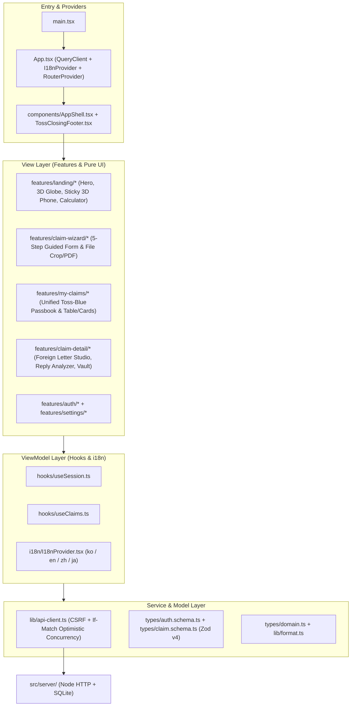

# ReLo 2.0 Frontend Architecture & Developer Onboarding Guide

이 문서는 처음 합류한 개발자도 `src/client/` 프론트엔드 코드베이스의 구조, 데이터 흐름, 다국어(`KO` / `EN` / `ZH` / `JA`) 설계, 3D 인터랙티브 섹션, 디자인 규칙을 즉시 파악할 수 있도록 정리한 아키텍처 가이드입니다.

---

## 1. 아키텍처 개요 (Clean MVVM Separation)

모든 `src/client/` 파일은 상단 첫 12줄 이내에 `@module`, `@layer`, `@purpose` JSDoc 메타데이터를 명시하며, 단일 `.tsx` 뷰 컴포넌트가 460줄을 넘지 않도록 역할별로 분리되어 있습니다.

---

## 2. 디렉토리 맵 (Directory Map)

| 경로 | 레이어 | 핵심 역할 |
| :--- | :--- | :--- |
| `src/client/i18n/` | **Model & Context** | 한국어(`ko.ts`), 영어(`en.ts`), 중국어 간체(`zh.ts`), 일본어(`ja.ts`) 실시간 전환 사전 및 `LanguageSwitcher` |
| `src/client/features/landing/` | **View / Canvas Engine** | 토스 스타일 랜딩: 실제 대륙 폴리곤(`worldLandPolygons.ts`) + 서울행 비행기 3D 지구본(`globeCanvasRenderer.ts`, `GlobalRefundGlobe.tsx`), 9:19.2 스마트폰 3D 스크롤 팝아웃(`PhoneHardwareFrame.tsx`, `TossPhoneScenes.tsx`), 차별점 비교표(`WhyReloSection.tsx`), 5단계 흐름도(`LandingFlowPlayground.tsx`), 예상 환불액 계산기(`RefundSimulatorSection.tsx`) |
| `src/client/features/claim-wizard/` | **ViewModel / View** | 비전문가도 3분 안에 작성하는 5단계 신청 위저드(`WizardPage.tsx`, `WizardStepsContent.tsx`, `WizardInvoiceScanCard.tsx`, `WizardStatusScreens.tsx`) |
| `src/client/features/my-claims/` | **View** | 통화별 통일된 토스 블루 컬러 시스템이 적용된 내 환불 통장(`ClaimsAnalyticsCard.tsx`) 및 카드/표 전환 목록(`ConsumerClaimsLedger.tsx`) |
| `src/client/features/claim-detail/` | **View** | 외국어 환불 편지 작성실(`ForeignMessageStudio.tsx`), 판매자 답장 해석기(`SellerReplyAnalyzer.tsx`), 10MB 영수증·사진 보관함(`ClaimFilesVaultCard.tsx`), 실제 입금 확인(`EvidenceAndSettlementTab.tsx`) |
| `src/client/components/` | **Shared UI** | 상단 내비게이션(`AppShell.tsx`), 토스 스타일 황혼 멀티컬럼 푸터(`TossClosingFooter.tsx`), 브랜드 오브 엠블럼(`ReloOrbEmblem.tsx`), Uppy·PDF·사진 자르기 미디어 모달(`components/media/*`) |
| `src/client/hooks/` | **ViewModel** | `@tanstack/react-query` 기반 세션·클레임·파일·AI 상태 동기화(`useSession.ts`, `useClaims.ts`) |
| `src/client/lib/` | **Service / Adapter** | `/api/*` HTTP 클라이언트(`api-client.ts`), 해시 스크롤 라우터(`router.tsx`), 통화 포매터(`format.ts`), Zod v4 리졸버(`zod-resolver.ts`) |
| `src/client/types/` | **Model** | 도메인 엔티티 인터페이스(`domain.ts`) 및 Zod v4 검증 스키마(`auth.schema.ts`, `claim.schema.ts`) |

---

## 3. 디자인 · 언어 · 코드 품질 불변 규칙 (Enforced by `npm run audit:client`)

1. **단일 액센트 컬러 하모니 (Unified Toss-Blue Harmony)**:
   - `KRW`, `EUR`, `USD`, `JPY`, `CNY` 등 모든 통화와 진행률 차트는 **Toss Electric Blue (`#1b64da` / `#3182f6`) + Sky (`#93c5fd`) + Cool Slate (`#cbd5e1` / `#333d4b` / `#191f28`)** 단일 계열만 사용합니다.
   - 통화마다 초록색(`#047857`)과 파란색(`#1b64da`)이 뒤섞이거나 보라색(`#4338ca`) AI 배지가 튀는 현상을 원천 차단합니다.
2. **쉬운 일상 소비자 언어 (Zero Jargon Policy)**:
   - 업계 은어나 개발 용어를 UI에 절대 노출하지 않습니다.
   - `배대지` -> **해외 배송 대행업체 / 반품 주소**, `인보이스` -> **영수증 / 주문 내역**, `크롭` -> **사진 자르기**, `유령 환불` -> **말뿐인 환불 약속**, `회수 원장` -> **환불 통장 / 입금 기록**.
3. **자동 품질 검증 명령어**:
   - `npm run audit:client` — 모든 클라이언트 파일의 `@module` 헤더, 컴포넌트 라인 수(`<= 460L`), 금지 용어/색상, 4개 국어 파일 무결성을 자동 검사합니다.
   - `npm run lint` — Biome 정적 분석 및 포맷 검사
   - `npm run typecheck` — TypeScript 엄격 타입 검사
   - `npm run build:react` — 프로덕션 번들 빌드 검증
   - `npm test` — 백엔드/HTTP 회귀 테스트
